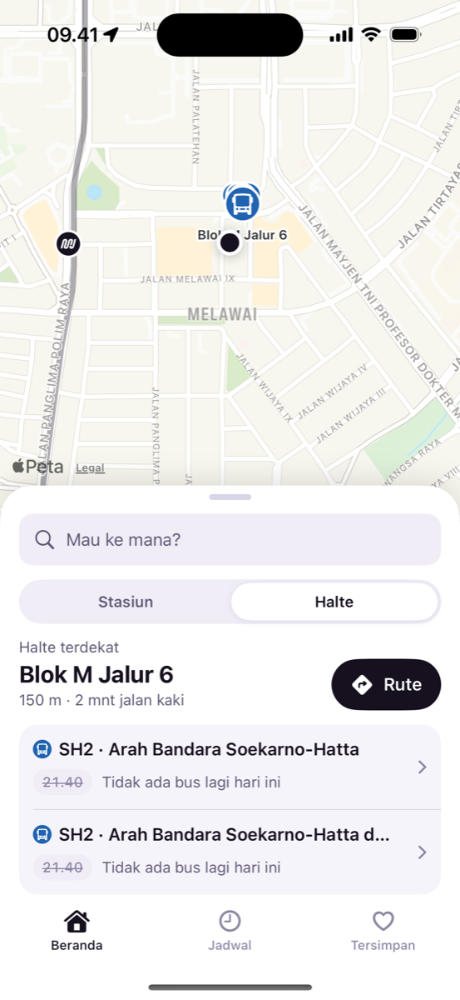
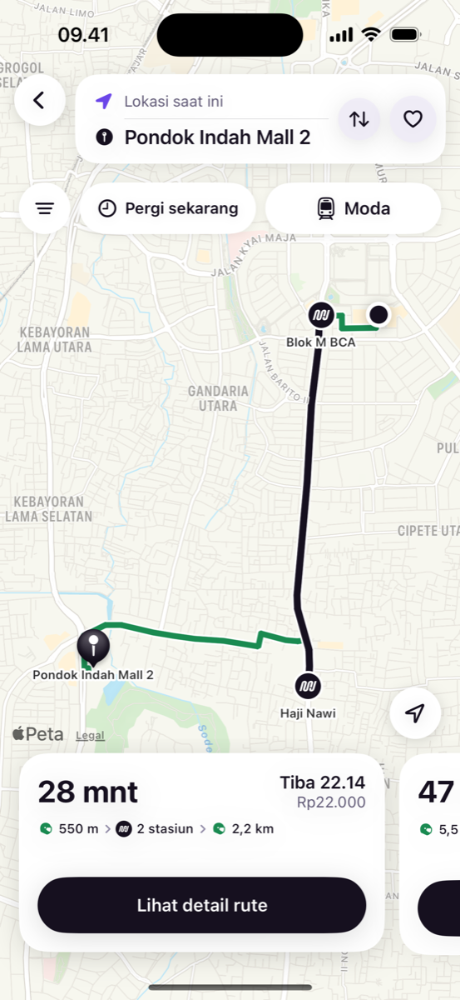
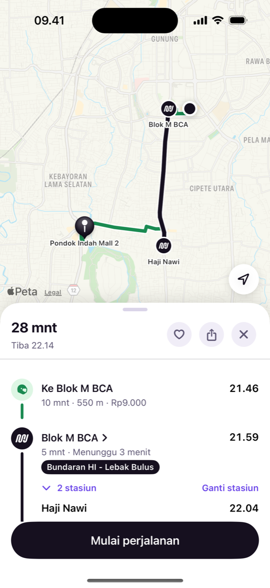
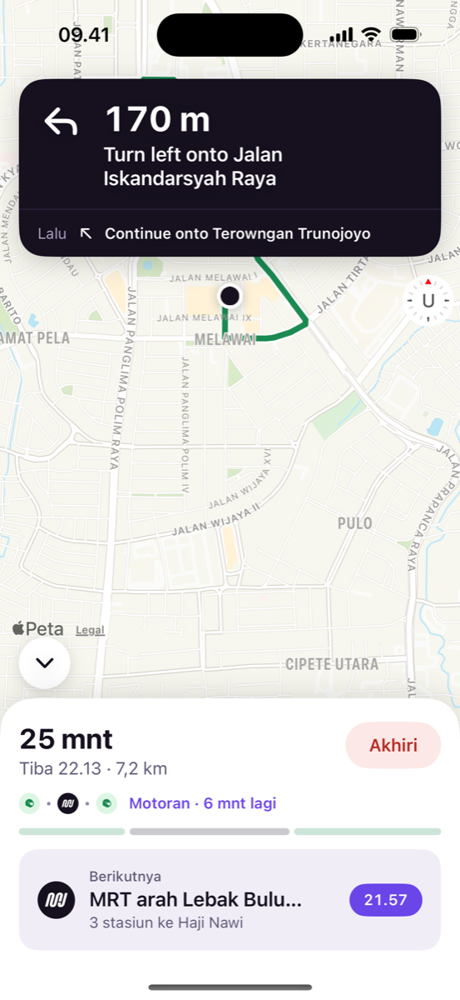
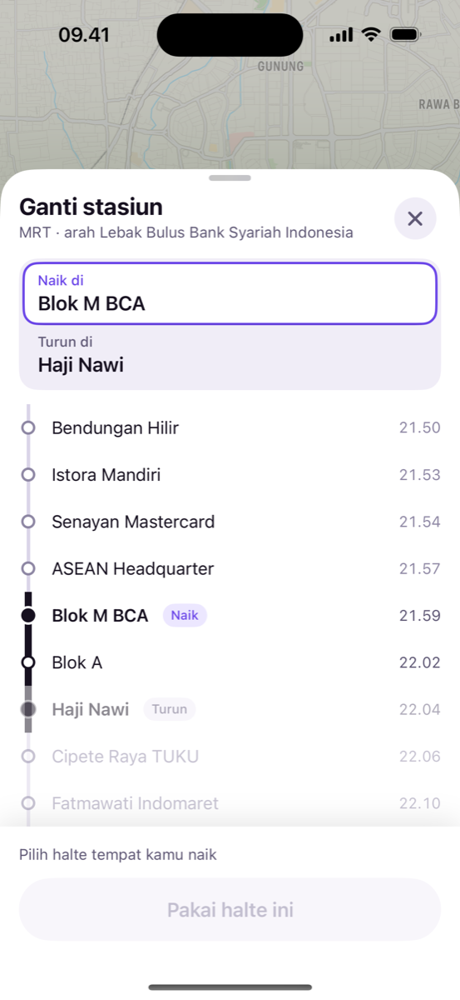
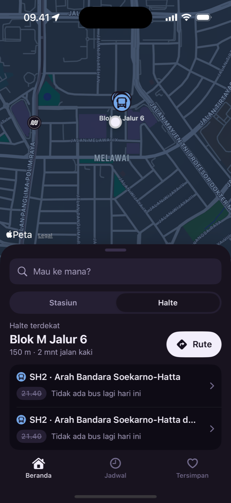
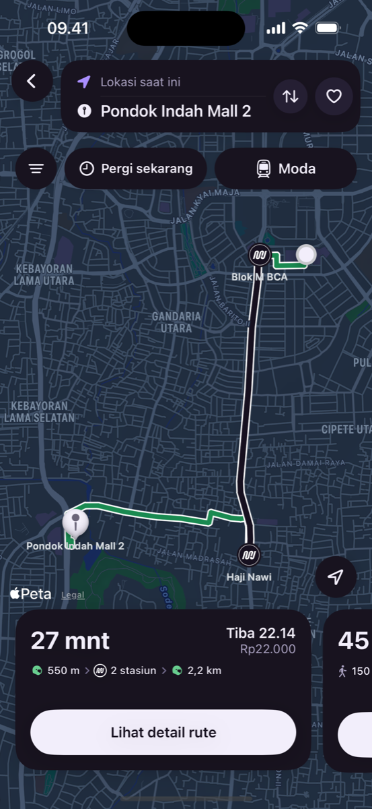

# Temu

**Temukan rute terbaikmu.**

Temu is an iOS app for getting around Jakarta on public transport. It plans door-to-door trips across MRT, KRL Commuterline, LRT Jabodebek, Transjakarta and JakLingko, including the walk or ojek at either end, then guides you turn by turn.

The source code is private. This repository is an overview of the product and how it is built.

  
  
  
  

## Features

- **Every reasonable route.** All ways of riding are shown, not only the fastest. A bus to MRT Fatmawati and then S61 is still offered when one long bus ride is a few minutes quicker on paper.
- **Multimodal.** Walking or ojek to the first stop, every transfer, and the last mile to the door, with estimated fares.
- **Switch modes without losing the trip.** Change the first or last leg between walking and ojek. The first vehicle's line never changes.
- **Change stops.** Board earlier for a better chance of a seat, or get off at another stop on the same line. A summary shows what changes before you apply it.
- **Turn by turn in the app.** Walking directions, ride progress stop by stop, and a fallback to the timetable underground. You can leave the guidance screen and it keeps running behind a live banner.
- **Plan ahead.** Leave now, or pick a weekday or weekend time. Plans for a chosen time stay fixed, like a printed timetable.
- **Saved places and routes,** with their starting point.
- **Light and dark mode,** following the system setting.

  
  
  

## How it works

| Layer | What it does |
| --- | --- |
| Data pipeline | Python scripts turn public GTFS and operator timetables into one bundled network: stations, lines, frequencies, transfers and track geometry. |
| Routing engine | A pure Swift package. Round-based public transit routing (RAPTOR) finds Pareto-optimal trips by arrival time and number of rides. Banning found lines one at a time brings up alternatives. A generalized cost ranks the options. |
| Street legs | Offline estimates first, so results are instant. MapKit walking and driving times then refine them, with toll roads avoided for ojek. |
| App | SwiftUI with The Composable Architecture, built in Clean Architecture layers. The planner, map and location are injected clients, so features are tested without a device. |

Routing quality is checked against 80 fixed trips across Jabodetabek before any ranking change ships. Around 120 automated tests cover the engine and the app's flows.

## Tech

Swift · SwiftUI · The Composable Architecture · MapKit · Core Location · Swift Package Manager · XcodeGen · Python (data pipeline) · Figma

## Status

In testing, will be published by the end of this year.
